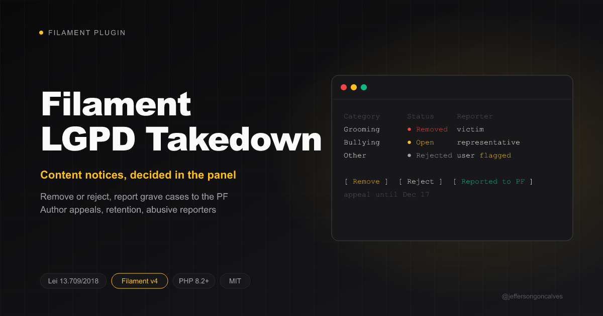

<div class="filament-hidden">



</div>

# Filament LGPD Takedown

[](https://packagist.org/packages/jeffersongoncalves/filament-lgpd-takedown)
[](https://github.com/jeffersongoncalves/filament-lgpd-takedown/actions?query=workflow%3Atests+branch%3A2.x)
[](https://github.com/jeffersongoncalves/filament-lgpd-takedown/actions?query=workflow%3A"Fix+PHP+code+styling"+branch%3A2.x)
[](https://packagist.org/packages/jeffersongoncalves/filament-lgpd-takedown)
[](LICENSE.md)

Decide the ECA Digital content notices (Lei 15.211/2025, arts. 27 to 30) collected by [laravel-lgpd-takedown](https://github.com/jeffersongoncalves/laravel-lgpd-takedown) in your Filament panel.

## Features

- **Notices list:** each notice shows its category (grave ones in red), the content, the reporter's role and email, the status, and what is still pending. Abusive reporters are flagged. Open notices are counted in the navigation badge.
- **Remove or reject:** both ask for a reason, and the author will see it (art. 30). Removing hides the content and keeps it as evidence for the Marco Civil period.
- **Report to the authorities:** for removed grave content (exploitation, sexual abuse, kidnapping, grooming, art. 27), record that it was reported to the Polícia Federal, with the protocol number.
- **Appeals:** read the author's appeal and decide it, restoring the content or keeping it removed.
- **View page:** the full notice, the decision, the retention period and the appeal, with the same actions.
- 19 languages.

## Compatibility

| Plugin Version                                                              | Filament |
|-----------------------------------------------------------------------------|----------|
| [1.x](https://github.com/jeffersongoncalves/filament-lgpd-takedown/tree/1.x) | 3.x      |
| [2.x](https://github.com/jeffersongoncalves/filament-lgpd-takedown/tree/2.x) | 4.x      |
| [3.x](https://github.com/jeffersongoncalves/filament-lgpd-takedown/tree/3.x) | 5.x      |

## Installation

You can install the package via composer:

```bash
composer require jeffersongoncalves/filament-lgpd-takedown:"^2.0"
php artisan vendor:publish --tag="lgpd-takedown-migrations"
php artisan migrate
```

## Usage

```php
use JeffersonGoncalves\Filament\LgpdTakedown\LgpdTakedownPlugin;

public function panel(Panel $panel): Panel
{
    return $panel
        ->plugins([
            LgpdTakedownPlugin::make()
                ->navigationGroup('LGPD')         // default: no group
                ->navigationSort(8)
                ->navigationIcon('heroicon-o-flag')
                ->slug('content-reports'),
        ]);
}
```

All fluent methods are optional.

> The resource has no authorization of its own. Register it only on panels whose users moderate content, or add a policy for `JeffersonGoncalves\LgpdTakedown\Models\ContentReport`.

## Testing

```bash
composer test
```

## Changelog

Please see [CHANGELOG](CHANGELOG.md) for more information on what has changed recently.

## Contributing

Please see [CONTRIBUTING](.github/CONTRIBUTING.md) for details.

## Security Vulnerabilities

Please review [our security policy](../../security/policy) on how to report security vulnerabilities.

## Credits

- [Jefferson Gonçalves](https://github.com/jeffersongoncalves)
- [All Contributors](../../contributors)

## License

The MIT License (MIT). Please see [License File](LICENSE.md) for more information.
